Releases ship weekly on Thursdays. Subscribe with the RSS button above to get each one as it lands.

<Update label="WK47-26" description="19 November 2026"
  rss={{ title: "WK47-26 — ", description: "" }}>
  {/* Imported from https://blog.pitchprint.com/release-wk26-47/ — check the bug-fix section reads as an <AccordionGroup>, and that every image has real alt text. */}

  Hi all 👋,

  It's been a little while since our last release note, but we haven't been sitting still! We're excited to share the latest improvements we've been working on, all with one goal in mind making PitchPrint easier and more enjoyable to use, for you and for your customers.

  **What's new** 🚀,

  **Prefill user data -** Picture a returning customer opening a design and having to type in their name, email, phone number, company and address all over again. It gets old fast. Now, when a logged-in customer starts a new design, PitchPrint fills in those details for them.

  We pull the details from the customer's **store account** first (billing, shipping and profile), and for anything still empty we look at their most recent saved PitchPrint projects. We also match your design's labels to the customer's details, even when the label isn't named exactly. "Postcode / ZIP", "Surname", "Tel." and even a typo like "Emial" will still find the right field. And if we're not sure what a label means, we leave it empty rather than guess.

  Prefill works with **WooCommerce** and **PrestaShop** store accounts. Other platforms use plugin data and saved projects. One thing to note if you're using the **Remove un-edited items** option on a Data Form, please switch it off on designs that use prefill for now, as untouched prefilled fields can be dropped when the design is saved.

  **Spell checker in the editor -** Text in the editor is typed straight onto the canvas, which means the browser's own spell check can't help there. So we gave the editor its own.

  Misspelled words get a red wavy underline on the canvas (it's for the screen only and never shows up in the PDF), and a little bubble pops up with suggestions while your customer is still typing. They can click a suggestion or press **Tab** to take the first one. Right-clicking a marked word shows suggestions too. We've also added word completion the rest of a likely word appears in faint text, and **Tab**, the **right arrow** or a click or tap accepts it. On phones and tablets, form fields show a tappable chip with the whole word. Before saving, any words still misspelled are listed so your customer can fix them, or save anyway.

  Words are checked using LanguageTool's online service, so your customer's text is sent to LanguageTool (hosted in Germany) for checking.

  <Frame>
    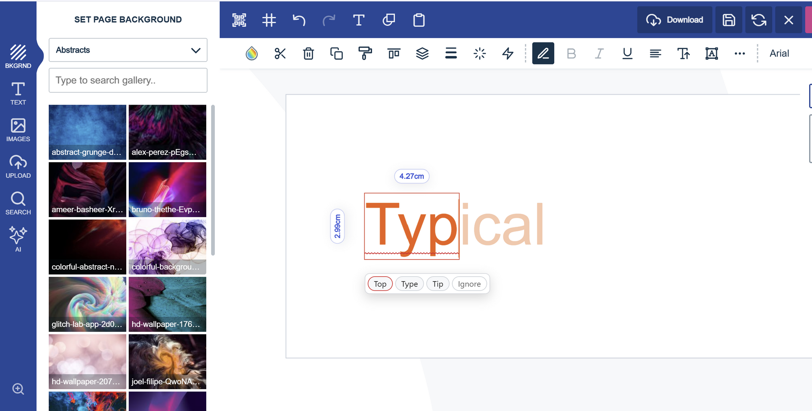
  </Frame>

  **Clone and delete a page in the editor -** Until now, if a customer wanted a second version of a page, they had to rebuild it from scratch. With the new **Clone Page** option, they can duplicate the page they're working on right from the editor and tweak the copy without touching the original. It's handy for trying out variations of a layout, or for multi-page designs where pages share the same style.

  Changed their mind about a page? There's a **Delete Page** option too. It asks the customer to confirm first, so a page can't disappear by accident.

  Together, they make it much easier to shape a design right in the editor.

  <Frame>
    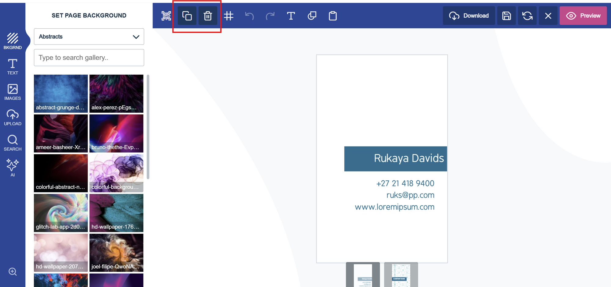
  </Frame>

  **Image and shape scale slider -** Resizing a photo used to mean clicking the **Shrink** and **Expand** buttons, which only moved the item in fixed steps and only showed up for photos. There was no way to resize a shape from the menu, and text already had a smooth slider, so it felt a bit inconsistent.

  Photos and shapes now get a **scale slider** in the context menu, replacing the old buttons and working just like the **Text Size** slider. Drag it to resize smoothly and precisely, from 20% to 300% of the size the item had when it was selected. The item grows and shrinks from its centre, and one drag counts as a single undo step.

  <Frame>
    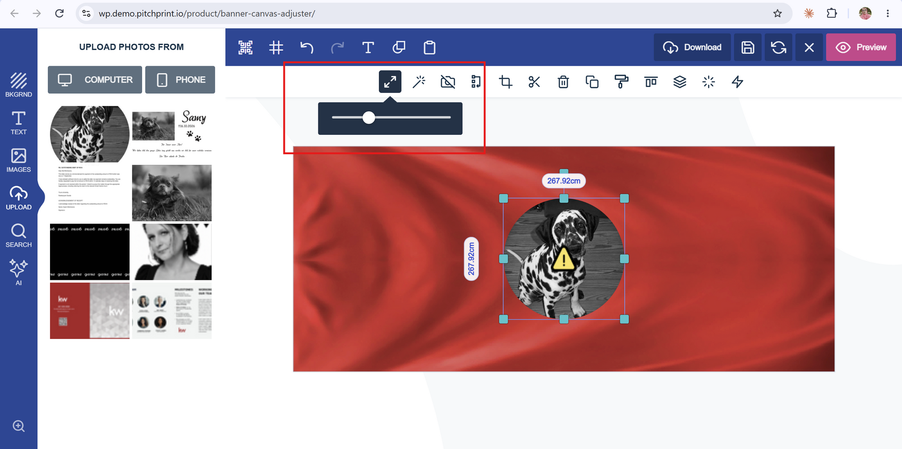
  </Frame>

  **Resizable Item Dimensions pop-up -** A while back we introduced **Show item dimensions**. Some of you told us the pop-up was a bit too big for your store, and we listened. You can now set the **height** and **font size** of the pop-up to suit your store and designs, and the width adjusts automatically to fit the text.

  <Frame>
    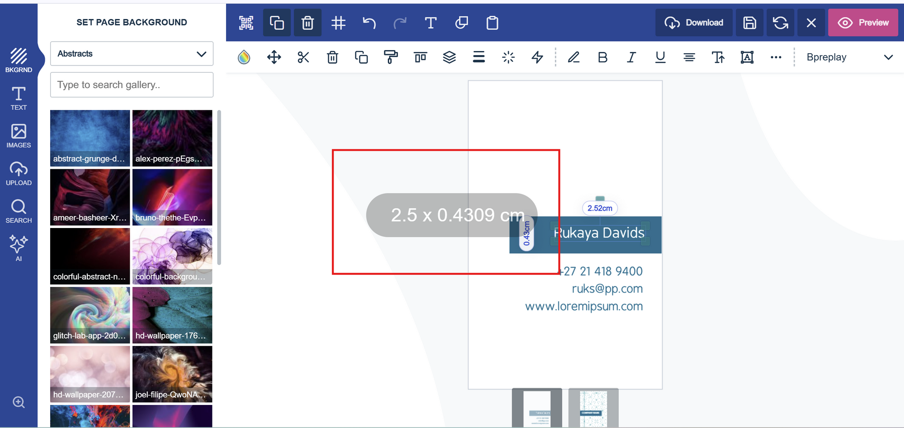
  </Frame>

  _We also fixed the following bug:_

  **Copy Styles and text spacing -** We've fixed an issue with the **Copy Styles** tool (the paint-roller icon in the item toolbar). It copied the colour, font and size of a text item, but not its spacing. **Line spacing** never carried over, **letter spacing** carried over but the text box wasn't updated until you edited the text, and the radius and spacing of **curved text** weren't copied at all.

  With this fix, Copy Styles also copies line spacing, letter spacing and curved text spacing, and the text box updates straight away, so pasted styles now match what you copied.

  If you'd like to take advantage of any of these new features, simply reach out to us at [support@pitchprint.com](mailto:support@pitchprint.com), tell us which ones you'd like, and we'll enable them on your domain.

  That's a wrap for this release, folks! Thanks for following along, and we look forward to sharing more with you soon. Have a wonderful weekend!

  From all of us at the PitchPrint team🤗

</Update>

<Update label="WK40-26" description="1 October 2026"
  rss={{ title: "WK40-26 — ", description: "" }}>
  {/* Imported from https://blog.pitchprint.com/release-wk26-40/ — check the bug-fix section reads as an <AccordionGroup>, and that every image has real alt text. */}

  Hi all👋,

  It’s been a while! We’re excited to share some of the latest improvements our team has been working on to make your experience with PitchPrint even better.

  **What's new**🚀,

  **Rename in My account page** - Keeping track of your designs just got a little easier. Until now, the **My Account** page allowed you to duplicate, resume, delete, and preview your designs and projects, but finding a specific one could become tricky once you started building up a larger list.

  You can now **rename your designs or projects directly from the My Account page**. Give your projects names that make sense to you, so they’re easier to recognise at a glance and keep organised.

  It also makes it much easier to **find the design or project you’re looking for and re-order your items** to keep everything in the right place.

  <Frame>
    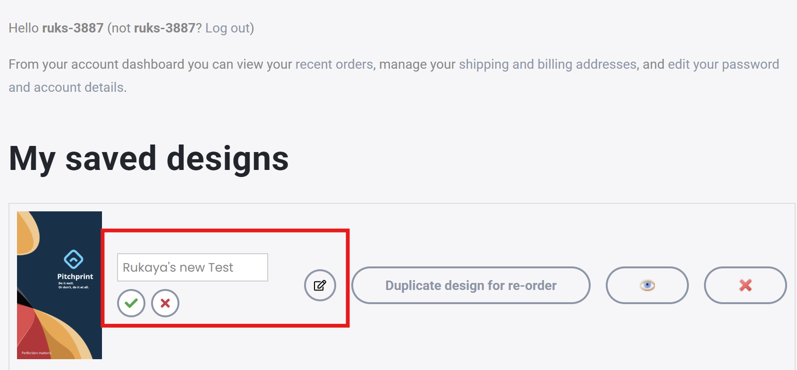
  </Frame>

  **Navbar for page Thumbnails** - Working with designs that have a lot of pages just got easier. Previously, the **page thumbnails at the bottom of the canvas** could get quite crowded once a design had more than 20 pages. This made it difficult to get to the later pages and, once there, just as difficult to get back to the earlier ones.

  We’ve now added a **navigation bar to the page thumbnails**. Once a design reaches **13 pages**, navigation arrows will appear, making it much easier to move through the pages.

  Use the arrows to **move forward to later pages or back to earlier ones**. As you scroll in either direction, the opposite arrow will become available, so you can easily move back and forth through all the pages in your design.

  <Frame>
    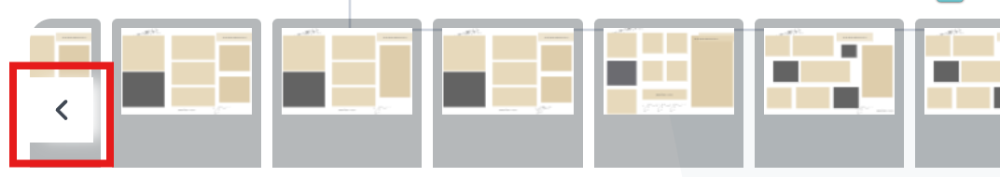
  </Frame>

  <Frame>
    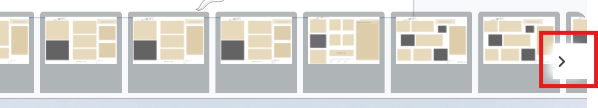
  </Frame>

  **Copy items from design to another** - Previously, the **Copy** option in the right-click menu only allowed you to copy an item from one page and paste it onto another page within the same design.

  We’ve now extended this functionality to the **front end of the editor**, so you can **copy an element from one design and paste it into a completely different design**. This makes it much easier to reuse elements across different projects without having to recreate them from scratch.

  Simply copy an element from one design, open another design, and paste it onto the canvas. It’s a small update, but one that should make working across multiple designs much easier and more convenient.

  **Copy button** - We’ve made copying elements a little easier and more obvious. Until now, the only ways to copy an item were to use **Ctrl + C** or right-click an element and select **Copy**. While both options work well, they weren’t always easy for users to discover.

  We’ve now added a **dedicated Copy button** to the editor, making the option much more visible and easier to access. It also sits right alongside the existing **Paste** button, so users can quickly copy and paste elements with just a click.

  It’s a small change, but one that makes these everyday tools much easier to find and use.

  **Keep text in Capitals** - We’ve added a handy new option for customers who want more control over how their text is formatted. If a design uses a specific capitalisation style, customers can now **apply that style directly within the front-end designer** when editing a field.

  Using the button shown below, customers can choose the capitalisation rule they want to use. Once selected, the editor will remember that setting and automatically apply it to any edits made to that field afterwards.

  <Frame>
    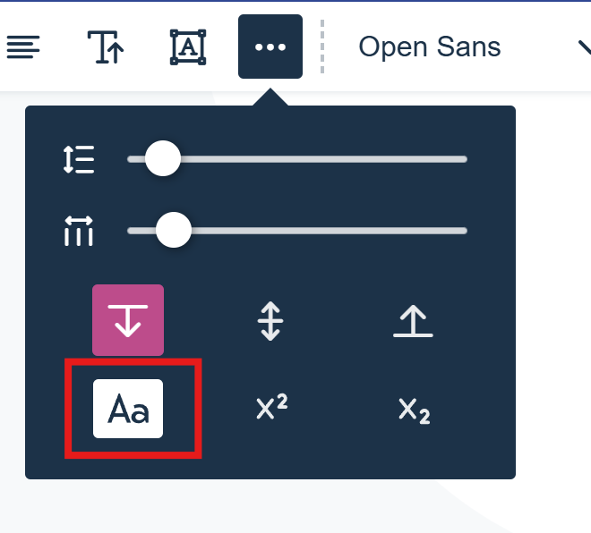
  </Frame>

  The rule is applied when the customer selects it in the designer, and will then be maintained for each consecutive edit. This makes it easier to keep text formatting consistent without having to manually adjust the capitalisation each time.

  That’s a wrap for this week, folks! 🎉

  If you’d like to take advantage of any of these new features, simply reach out to us at [**support@pitchprint.com**](mailto:support@pitchprint.com), and we’ll be happy to enable the features you’re interested in on your domain.

  That’s all for this release! We’ll be back with more updates and improvements in the next one.

  Until then, have a wonderful weekend!

  **The PitchPrint Team 🤗**

</Update>

<Update label="WK26-26" description="25 June 2026"
  rss={{ title: "WK26-26 — Show item dimensions, How to enable this feature", description: "Show item dimensions, How to enable this feature, Canvas Adjuster predefined and custom values, How it works." }}>
  **Show item dimensions, How to enable this feature, Canvas Adjuster predefined and custom values, How it works.**

  We’re back with another round of updates, and as always, we’re excited to share what the team has been working on to keep improving the PitchPrint experience for you and your customers.

  ### Show item dimensions

  One of the most requested canvas improvements is finally here. You can now view an item’s dimensions directly on the canvas while resizing, making it much easier to size and position elements with precision.

  When an item is selected or active on the canvas, its dimensions will now be displayed automatically.

  ### How to enable this feature

  1. Go to [admin settings](https://admin.pitchprint.com/settings)
  2. Enable the option shown in the screenshot below:

  <Frame>
    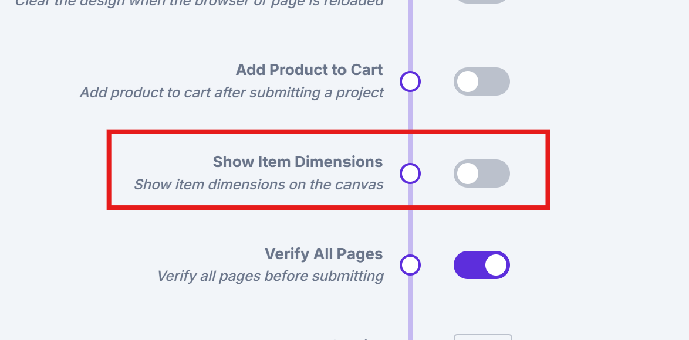
  </Frame>

  Once enabled, item dimensions will be displayed on each active item directly on the canvas, as shown below.

  <Frame>
    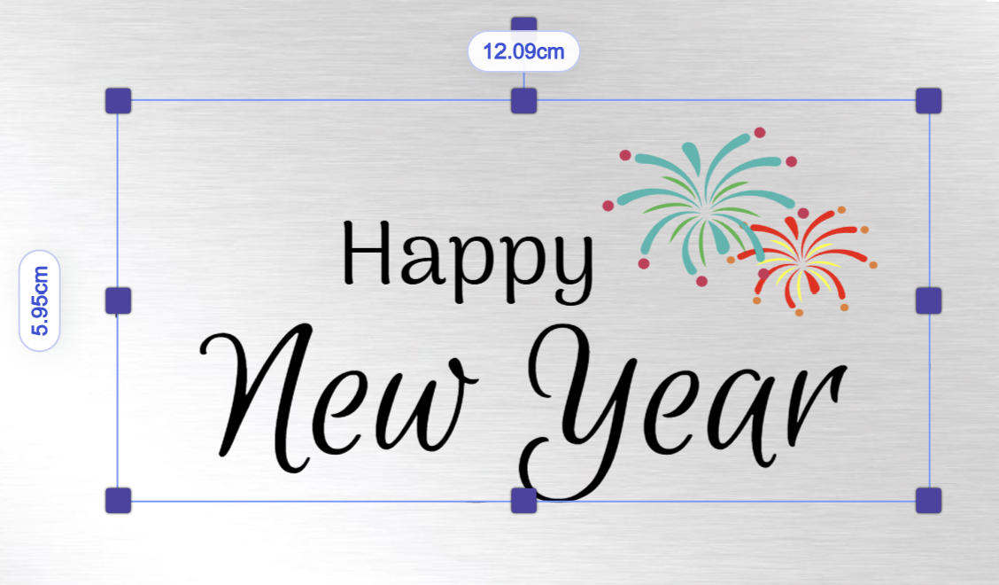
  </Frame>

  ### Canvas Adjuster predefined and custom values

  We’ve improved the Canvas Adjuster Module to make sizing workflows more flexible. Previously, the module could only work with **predefined values** or **custom values**—not both at the same time.

  The variation element selector field also only supported one setup at a time: either a unique selector for predefined sizing options, or separate width and height selectors for custom sizing.

  With this update, you can now use **both predefined and custom values together**. When **Custom Values** is enabled, an additional field will appear, allowing you to add the unique selector needed for your predefined values.

  ### How it works

  **Field 1** (marked in red below) should contain the selector for your **predefined values field** from your site. Example: `#size`

  <Frame>
    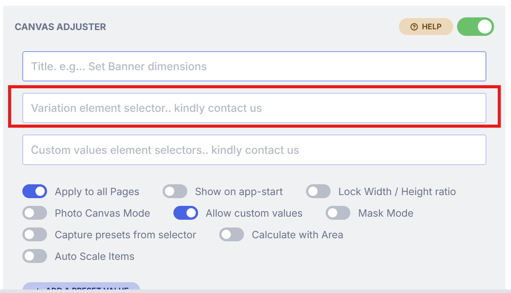
  </Frame>

  **Field 2** (marked in red below) should contain the selectors for your **custom width and height fields** from your site.
  Example: `#selectorWidth, #selectorHeight`

  <Frame>
    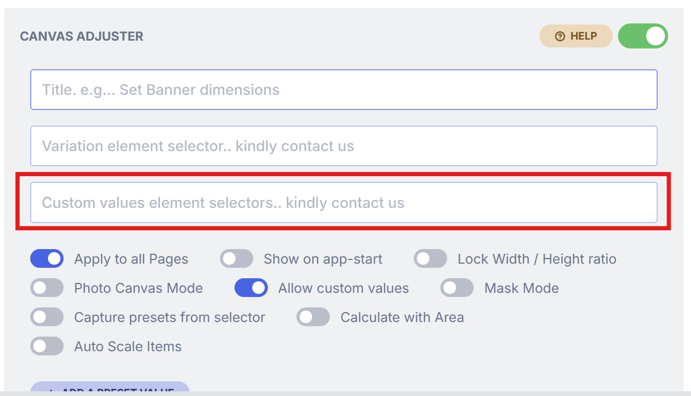
  </Frame>

  <AccordionGroup>
    <Accordion title="Bug fixes" icon="bug">
      ### Page Loader and Thumbnails

      We’ve fixed an issue in the **Page Loader Module** that affected custom thumbnails on the front end.

      The module allows admins to either assign a custom thumbnail or use the design preview as the thumbnail shown to customers. An issue was preventing custom thumbnails from pulling through correctly to the front end of the design setup.

      With this fix, **both custom thumbnails and default design thumbnails should now display as expected** in the front end.

      Please refer to the image below for reference:

      <Frame>
        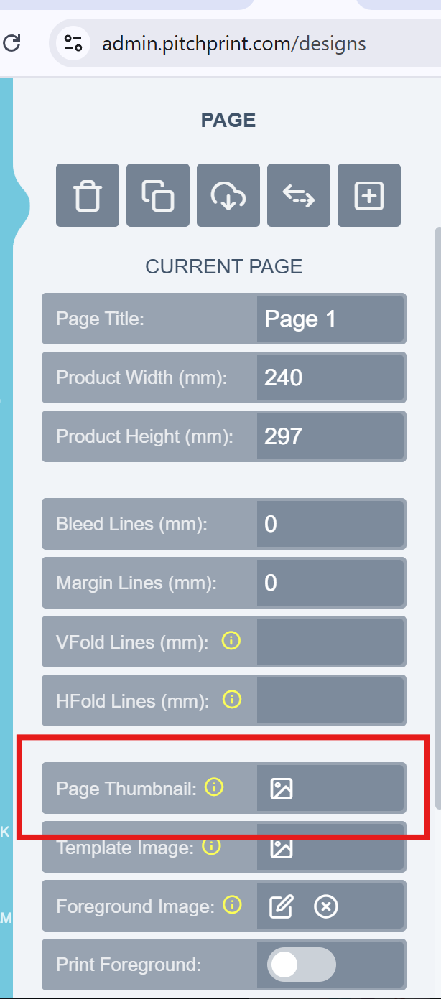
      </Frame>

      ### Background Tab and Remix Module issue

      We’ve fixed an issue where images in the **Background** tab would not display whenever the **Remix Module** was enabled on a design.

      With this update, **all background resources should now display correctly**, even when the Remix Module or other supported modules are active.

      ### Product page uploader

      We’ve fixed an issue in the **Product Page Uploader** where uploaded file previews could appear cut off after upload.

      With this update, file previews should now display correctly and in full once an upload is completed.

      That’s it for this week’s updates — thanks for following along, and we look forward to sharing more with you soon.

      From all of us at the PitchPrint team🤗
    </Accordion>
  </AccordionGroup>
</Update>

<Update label="WK19-26" description="7 May 2026"
  rss={{ title: "WK19-26 — Shopify My Designs Extension, Eyedropper Color Picker", description: "Shopify My Designs Extension, Eyedropper Color Picker, How to Enable This Feature, Distribute Items." }}>
  **Shopify My Designs Extension, Eyedropper Color Picker, How to Enable This Feature, Distribute Items.**

  New look, more power! We’re back with our latest round of updates, all designed with one goal in mind: making your life on PitchPrint smoother, faster, and a lot more fun.

  ### Shopify My Designs Extension

  Previously, our “My Designs” page was integrated into our plugin, where we would attempt to locate the native account URL to display the saved designs table. This method proved unreliable due to custom URLs and Shopify’s various account page structures. With the recent deprecation of legacy account pages, this led to significant inconsistencies in how the designs table was displayed.

  To ensure a more stable and seamless experience, we have completely rebuilt the accounts page from the ground up as a native **Shopify App Extension**. The “My Designs” table can now be enabled directly within your Shopify Theme Editor, providing a more reliable and integrated feel for your customers.

  **How to Enable the Designs Table:**To activate the new extension on your store, please follow these steps:

  1. Navigate to your **Shopify Theme Editor**.
  2. Go to the **App Embeds** section.
  3. Locate the **PitchPrint My Designs** extension and toggle it to **Enabled**.
  4. **Save** your changes.

  Please refer to the images below for reference:

  <Frame>
    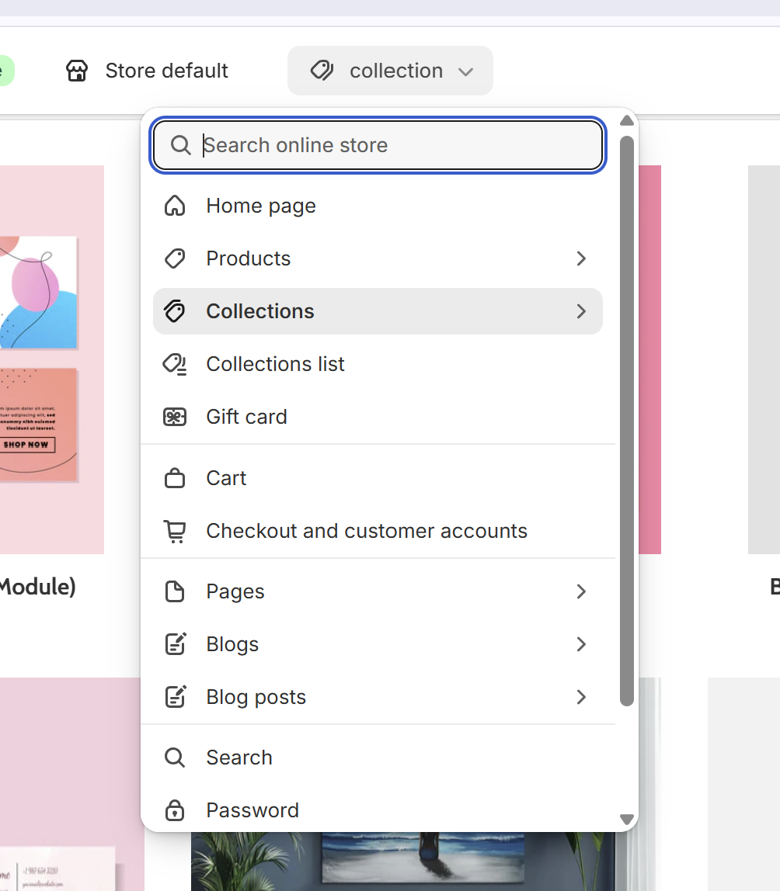
  </Frame>

  <Frame>
    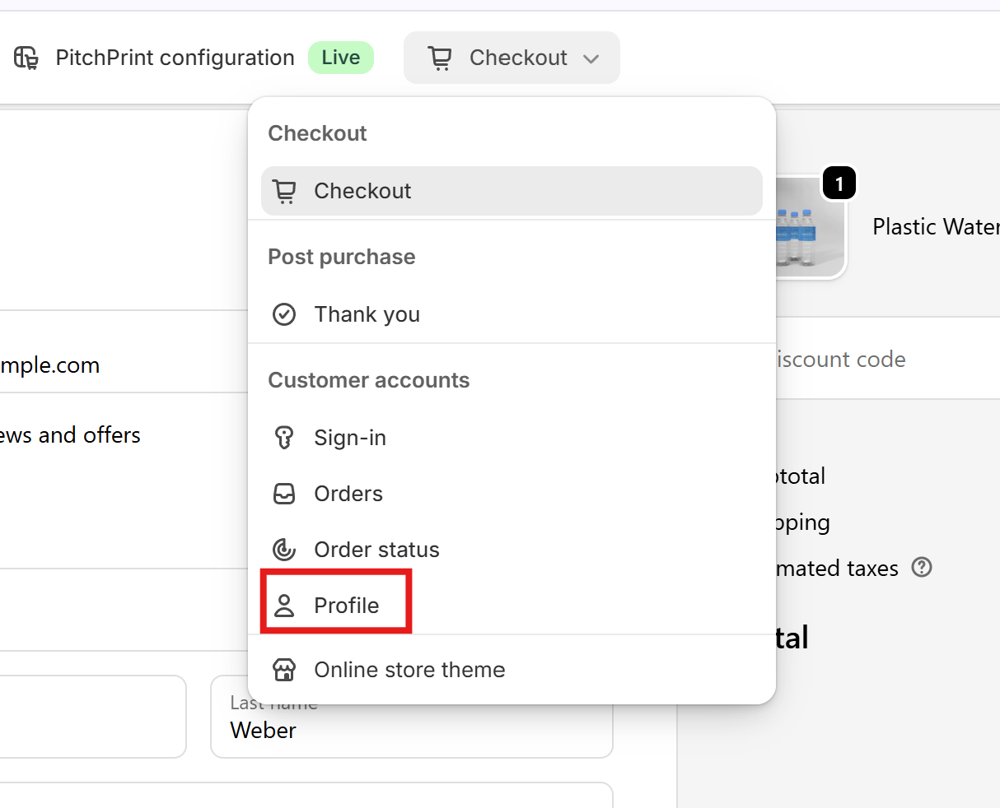
  </Frame>

  <Frame>
    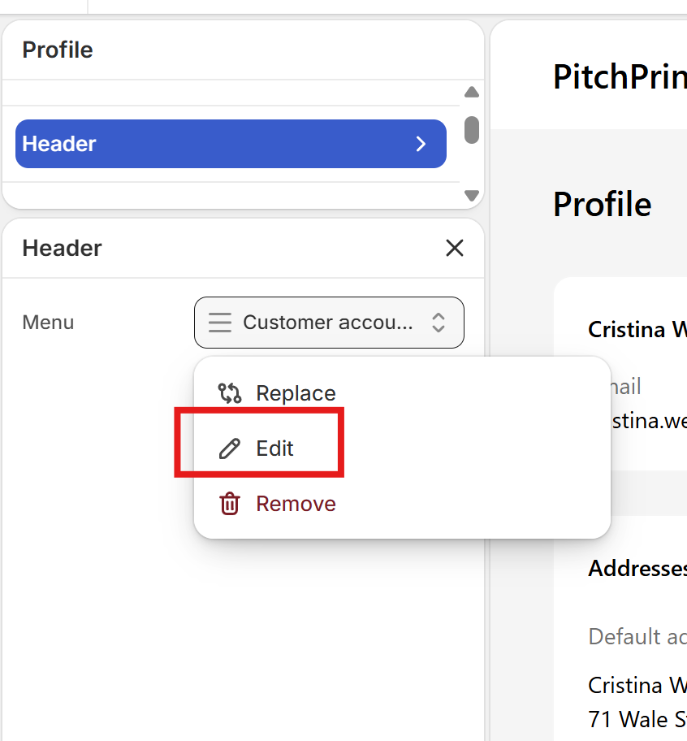
  </Frame>

  <Frame>
    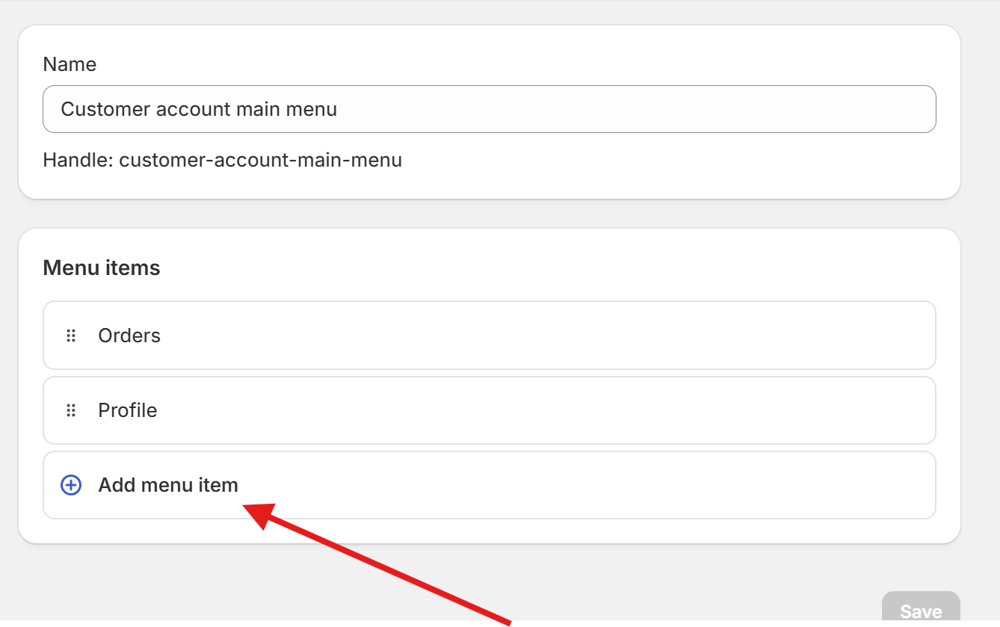
  </Frame>

  <Frame>
    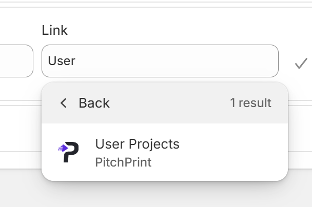
  </Frame>

  <Frame>
    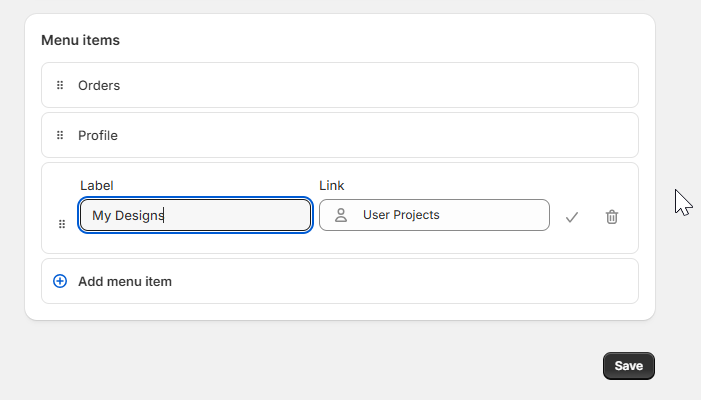
  </Frame>

  <Frame>
    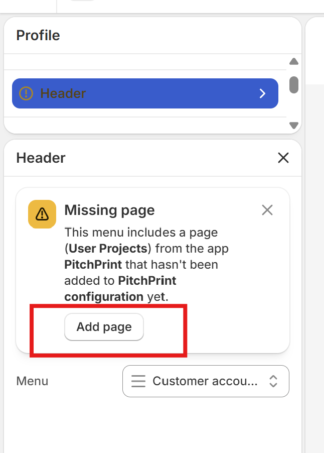
  </Frame>

  That’s it! You have successfully created a dedicated “My Designs” page where your customers can easily view their saved projects and previous orders.

  ### Eyedropper Color Picker

  We are excited to introduce the Eyedropper Color Picker, a powerful tool designed to streamline the design process for your customers. This feature allows users to select an item within the editor to instantly capture its specific color. Once captured, that color can be applied to any other item on the canvas with a single click. By allowing users to sample colors directly from their workspace, this tool makes it easier than ever to maintain a consistent visual theme and achieve perfect color harmony across all design elements.

  ### How to Enable This Feature

  To activate the Eyedropper tool on your account, please perform the following steps:

  1. **Reload** [**Layouts**](https://admin.pitchprint.com/layouts) within your admin settings.
  2. **Resave** [**Styling**](https://admin.pitchprint.com/styling) to apply the update to your editor.

  Once enabled, the Eyedropper icon will be available within the standard color menu.

  Please refer to the image below for reference:

  <Frame>
    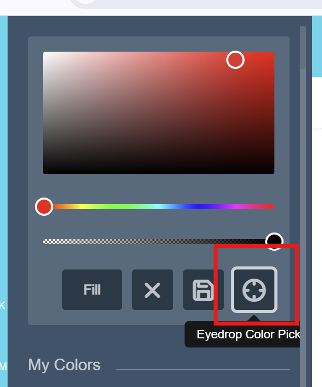
  </Frame>

  To apply a custom color, simply select the target item on your canvas and open the **Color Picker** from the **Add Color** menu. You can then use the eyedropper tool to hover over any existing color in the editor that you wish to sample. Once selected, the color will be instantly applied to your item, ensuring perfect consistency across your design.

  ### Distribute Items

  We know how frustrating it is to spend time “eyeballing” the gaps between photos or text blocks to get them perfectly aligned. To make your life easier, we’ve added a new Distribute feature that handles the math for you. You can now select a group of items and instantly add perfectly equal spacing between them, either vertically or horizontally. It’s a small tweak that makes a massive difference in keeping your designs looking clean and professional without the manual effort.

  <AccordionGroup>
    <Accordion title="Bug fixes" icon="bug">
      ### AI Text to Image Improvements

      We’ve fine-tuned our AI generation tool to give you much sharper, high-quality results. One of the biggest hurdles with AI-generated images has always been clear text, but with this update, any text embedded within your generated images should now render much more legibly and accurately.

      ### Faster, High-Quality Background Removal

      We’ve also given our background removal tool a significant boost. Not only will your images maintain better quality after the background is stripped away, but the processing time is now much faster. It’s a smoother, quicker way to get those clean product shots ready for your designs.

      Well, that’s it for this week, folks! We’ll see you in our next release note with even more exciting updates and fixes.
    </Accordion>
  </AccordionGroup>

  Have a lovely weekend, The PitchPrint Team😊
</Update>

<Update label="WK12-26" description="19 March 2026"
  rss={{ title: "WK12-26 — Edit User Name in PitchPrint Admin, Move Designs Across Categories", description: "Edit User Name in PitchPrint Admin, Move Designs Across Categories, Scale Grouped Items in Canvas Adjuster." }}>
  **Edit User Name in PitchPrint Admin, Move Designs Across Categories, Scale Grouped Items in Canvas Adjuster.**
  We’re pleased to share our latest updates, as we continue to enhance and improve your experience on PitchPrint.

  ### Edit User Name in PitchPrint Admin

  Previously, administrators could only modify the store association and access permissions for an admin user. This update introduces the ability to edit user and admin names directly within the PitchPrint admin panel.

  Please refer to the image below for reference:

  <Frame>
    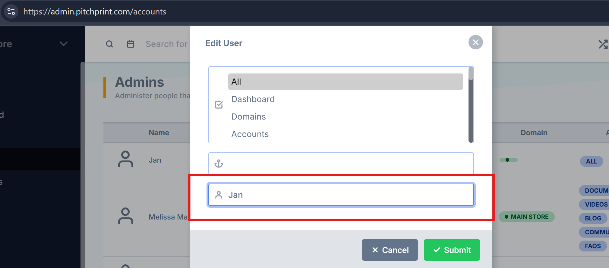
  </Frame>

  ### Move Designs Across Categories

  The move functionality has been reintroduced in the PitchPrint admin. This feature was previously removed while we refined its behavior, and it has now been fully rebuilt for improved reliability. You can now easily move designs between categories.

  Please refer to the image below for reference:

  <Frame>
    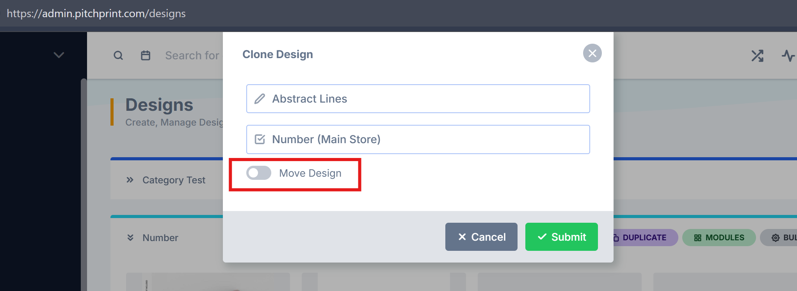
  </Frame>

  ### Scale Grouped Items in Canvas Adjuster

  We’ve enhanced the canvas adjuster to support automatic scaling for grouped items. Previously, this feature worked well for individual elements but did not fully support groups. With this update, grouped items will now scale proportionally when customers adjust canvas dimensions, ensuring a more consistent and reliable design experience.

  Please refer to the image below for reference:

  <Frame>
    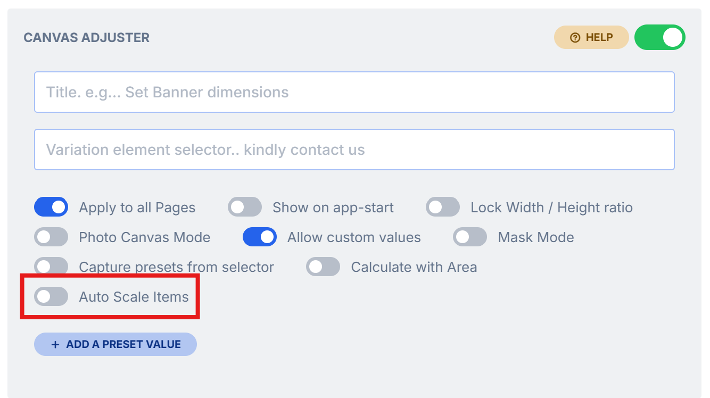
  </Frame>

  <AccordionGroup>
    <Accordion title="Bug fixes" icon="bug">
      ### Right-Click Copy and Paste

      An issue affecting right-click copy and paste functionality has been resolved. Users can now reliably copy items from the editor, paste content into the editor, and transfer items between pages as expected.

      Please refer to the images below for reference:

      <Frame>
        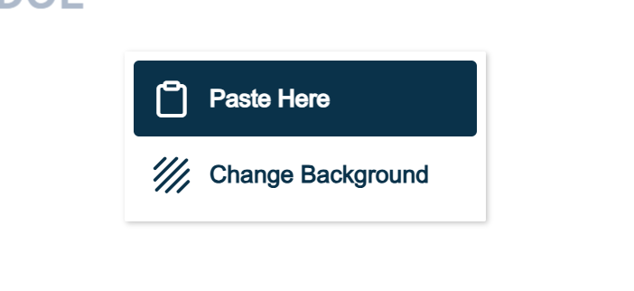
      </Frame>

      <Frame>
        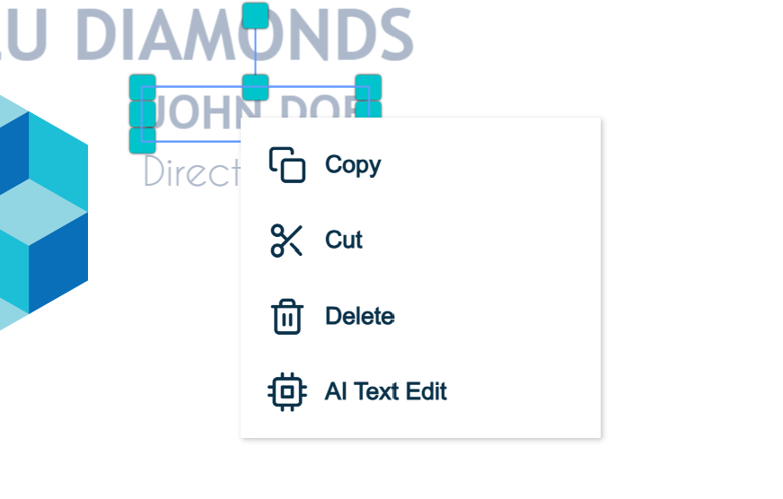
      </Frame>

      ### Issue with new color and Design Configuration

      One of our customers reported an issue whereby sometimes the design settings would be cleared upon opening it. We troubleshooted and traced the root cause back to an issue in the new text color value. We’ve since made an update to fix the issue and all settings should remain visible in the design configuration.

      ### 3D Model Pagination Fix

      We resolved an issue affecting the 3D model pagination feature, where models not included in the initially loaded set could be unintentionally removed from a design after updating and saving the design configuration. This has been corrected, and models will now remain properly assigned to a design regardless of their position within the paginated model list.

      Please refer to the image below for reference:

      <Frame>
        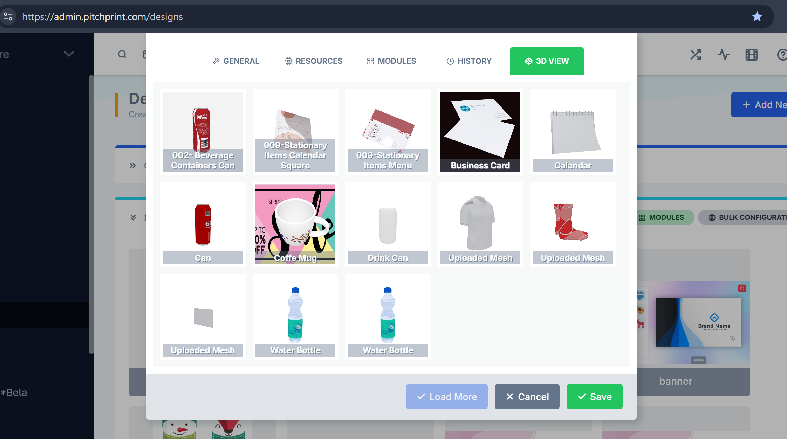
      </Frame>

      That’s all for this week. We look forward to sharing more new features and improvements in our next release.
    </Accordion>
  </AccordionGroup>

  Wishing you a wonderful weekend,
  The PitchPrint Team😊
</Update>

<Update label="WK09-26" description="26 February 2026"
  rss={{ title: "WK09-26 — 3D Designs Search and Filter, Option to Close Design Configuration Without Adding a Title", description: "3D Designs Search and Filter, Option to Close Design Configuration Without Adding a Title, New 3D scenes." }}>
  **3D Designs Search and Filter, Option to Close Design Configuration Without Adding a Title, New 3D scenes.**
  Welcome to our first release of 2026 — better late than never!

  We have an exciting year ahead, with a strong focus on improving platform stability and resolving existing issues to enhance your overall experience. Alongside these improvements, we’ll also be introducing several new features designed to add even more value to the platform.

  ### 3D Designs Search and Filter

  We’ve added the ability to **search for 3D models by name**. This feature is especially useful for stores with a large library of models, allowing you to quickly locate a specific design without having to navigate through multiple pages. It’s a simple but powerful enhancement to help you manage your 3D assets more efficiently.

  ### Option to Close Design Configuration Without Adding a Title

  Previously, the **Design Configuration** window could not be closed if the title field was left empty, which made it difficult to exit without entering a title.

  We’ve now updated this behavior: closing or cancelling the window is now possible even when the title field is empty, giving you the flexibility to exit the configuration smoothly without being forced to add a title.

  ### New 3D scenes

  <Frame>
    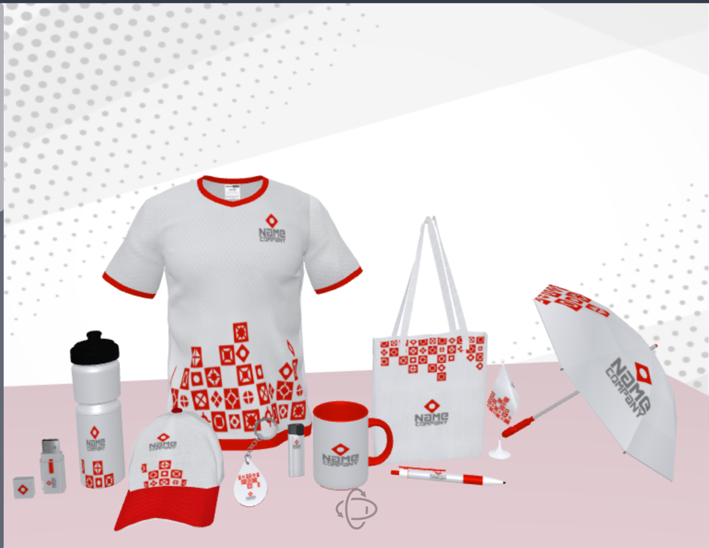
  </Frame>

  <Frame>
    
  </Frame>

  <Frame>
    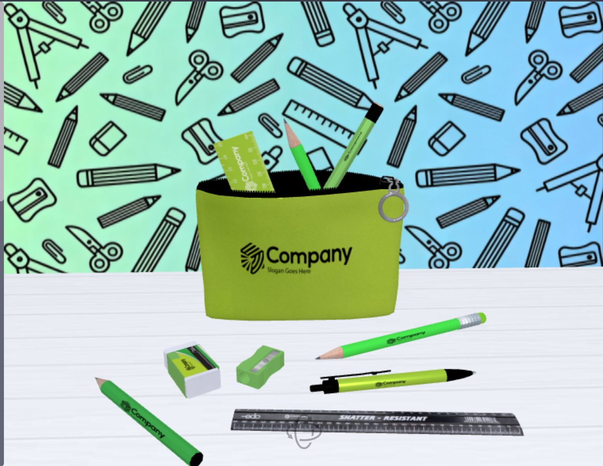
  </Frame>

  <Frame>
    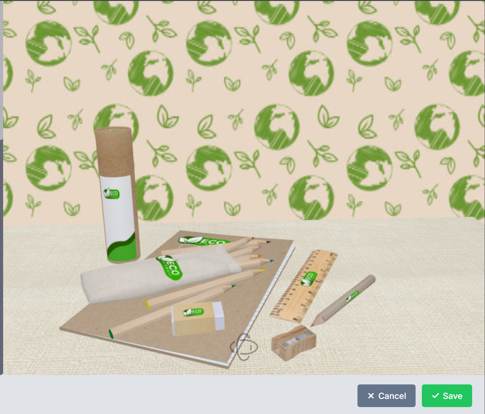
  </Frame>

  <Frame>
    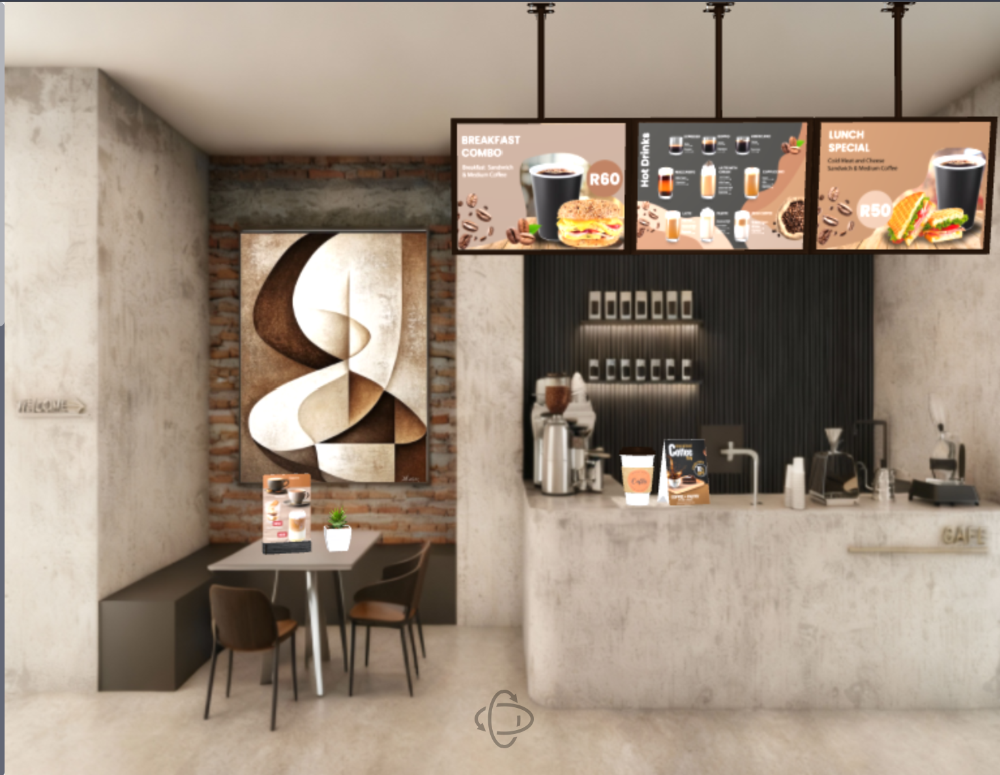
  </Frame>

  <Frame>
    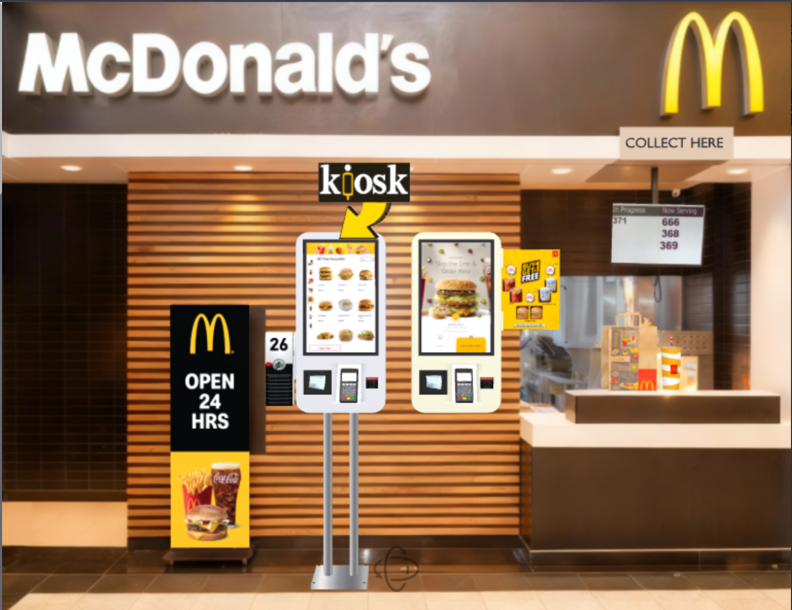
  </Frame>

  <AccordionGroup>
    <Accordion title="Bug fixes" icon="bug">
      ### AI and EPS Upload Fix

      We resolved an issue that was preventing AI and EPS files from uploading correctly. This has now been fixed, and both file formats are functioning as expected.

      ### Add New Page

      We resolved an issue where end users were still able to add a new page via the Page Loader module, even when this functionality was disabled.

      This has now been corrected. When the **“Add New Page”** feature is disabled, clicking the button will no longer trigger any action. We also fixed an issue where clicking on the page thumbnail would also add a new page.

      With this update, the feature now fully respects the disabled setting and prevents end users from adding additional pages when it is turned off.

      That’s all for this week!

      We look forward to sharing more updates with you in our next release.
    </Accordion>
  </AccordionGroup>

  Wishing you a wonderful weekend.
  — The PitchPrint Team🤗
</Update>
